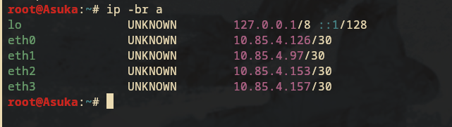
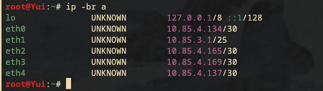
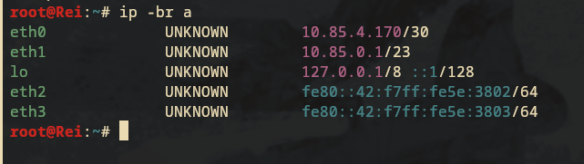
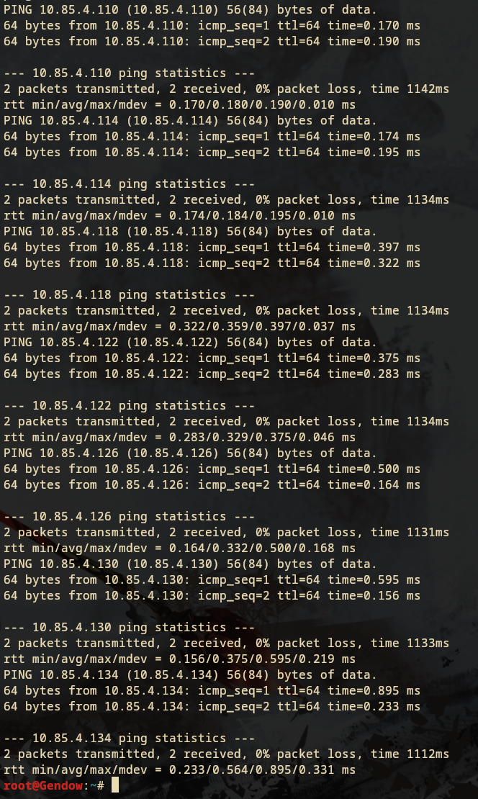
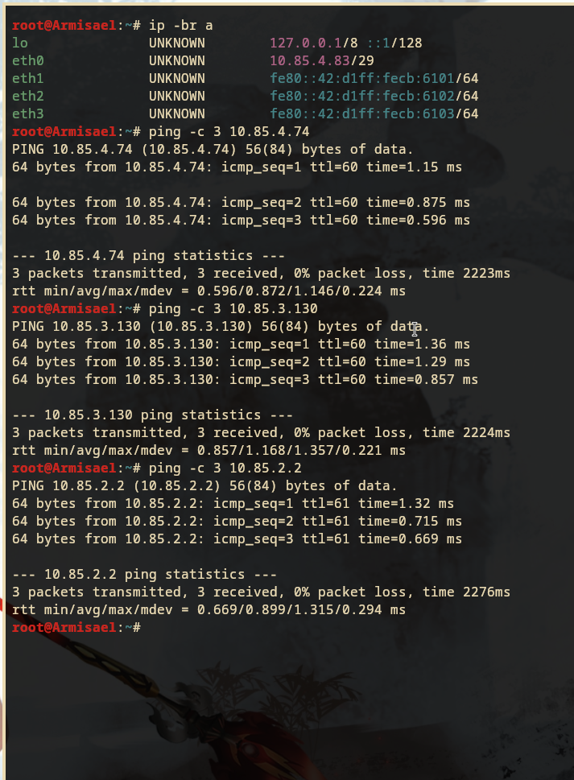
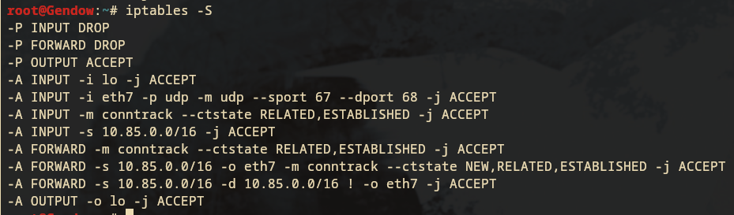
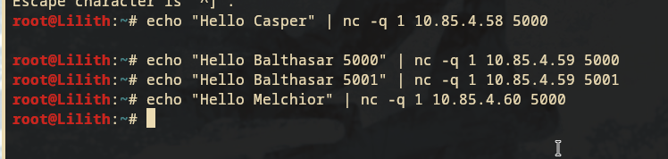
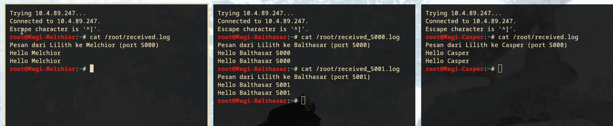
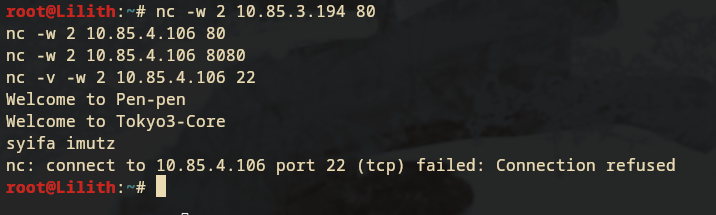

# Laporan Resmi Praktikum Modul 5 Jaringan Komputer 2026
## *Operation Geofront* — Kelompok K-43

**Anggota Kelompok:**
- Kelompok K-43 (Group B — GNS3 Host: `10.4.89.247`)
- Blok Subnet: `10.85.0.0/16`

---

## Daftar Isi
1. [Babak 1 — Soal 1: Pembagian Alamat VLSM & Tree IP](#soal-1--pembagian-alamat-vlsm--tree-ip)
2. [Babak 1 — Soal 2: IP Addressing 17 Router & Ping Ujung Link](#soal-2--ip-addressing-17-router--ping-ujung-link)
3. [Babak 1 — Soal 3: Routing Statis & CIDR Summarization](#soal-3--routing-statis--cidr-summarization)
4. [Babak 1 — Soal 4: Akses Internet & NAT Masquerade Gendo](#soal-4--akses-internet--nat-masquerade-gendo)
5. [Babak 1 — Soal 5: Firewall Hardening Gendo (Default Policy DROP)](#soal-5--firewall-hardening-gendo-default-policy-drop)
6. [Babak 1 — Soal 6: IP Statis Permanen Non-Router & Uji Gateway Unit-01](#soal-6--ip-statis-permanen-non-router--uji-gateway-unit-01)
7. [Babak 1 — Soal 7: Membangunkan Layanan MAGI (Netcat Listener)](#soal-7--membangunkan-layanan-magi-netcat-listener)
8. [Babak 1 — Soal 8: Mengenali Kondisi Normal & Uji Layanan](#soal-8--mengenali-kondisi-normal--uji-layanan)

---

## Soal 1 — Pembagian Alamat VLSM & Tree IP
- Pembagian subnet dilakukan berdasarkan kebutuhan host terbesar (termasuk +1 gateway) dengan aturan tie-break: ukuran sama didahulukan segmen LAN dibanding link router-ke-router, kemudian urutan nomor tabel.
- File rincian subnetting tersedia pada spreadsheet: [`subneting.xlsx`](subneting.xlsx).
- Total segmen: 17 LAN dan 16 Link Point-to-Point (/30).

---

## Soal 2 — IP Addressing 17 Router & Ping Ujung Link
Setiap router dikonfigurasi dengan IP statis dan `net.ipv4.ip_forward=1`. Router Gendo memperoleh alamat dinamis dari NAT1 via interface WAN `eth7`.

### A. Tampilan `ip -br a` pada 17 Router
| No | Router | Screenshot |
|:--:|:-------|:-----------|
| 1 | **Gendow** |  |
| 2 | **Fuyutsuki** |  |
| 3 | **Maya** |  |
| 4 | **Toji** |  |
| 5 | **Shigeru** |  |
| 6 | **Makoto** |  |
| 7 | **Misato** |  |
| 8 | **Kaji** |  |
| 9 | **Asuka** |  |
| 10 | **Ritsuko** |  |
| 11 | **Kensuke** |  |
| 12 | **Hikari** |  |
| 13 | **Kowaru** |  |
| 14 | **Yui** |  |
| 15 | **Mari** |  |
| 16 | **Rei** |  |
| 17 | **Shinji** |  |

### B. Ping Dua Ujung Tiap Link Router-ke-Router
- **Gendow ke 7 Router Cabang**:  
  
- **Cabang Fuyutsuki & Shigeru**:  
  
- **Cabang Asuka & Hikari**:  
  
- **Cabang Yui**:  
  

---

## Soal 3 — Routing Statis & CIDR Summarization
Routing statis diatur dengan prinsip hierarki efisien:
- Router cabang mengarahkan default route ke router induk di atasnya.
- Router Gendo mengarahkan rute spesifik ke masing-masing cabang, dengan ringkasan CIDR pada cabang Shigeru (Switch-Monolith `10.85.4.80/29` + Switch-Radar `10.85.4.88/29` diringkas tepat menjadi `10.85.4.80/28`).
- Bukti ping dari **Armisael** (`10.85.4.83`) ke:
  - **Lilith** (`10.85.4.74`)
  - **Sachiel** (`10.85.3.130`)
  - **Comm-Net** (`10.85.2.2`)  
  

---

## Soal 4 — Akses Internet & NAT Masquerade Gendo
- Router Gendo menerapkan NAT Masquerade pada dynamic WAN interface `eth7`:
  ```bash
  iptables -t nat -A POSTROUTING -s 10.85.0.0/16 -o eth7 -j MASQUERADE
  ```
- DNS nameserver dikonfigurasi pada `/etc/resolv.conf`.
- Bukti ping `8.8.8.8` dan domain `deb.debian.org` dari node internal:  
  
- Bukti counter rule NAT bertambah di Gendow (`iptables -t nat -nvL POSTROUTING`):  
  

---

## Soal 5 — Firewall Hardening Gendo (Default Policy DROP)
Router Gendo menerapkan firewall stateful:
- Policy default rantai `INPUT` dan `FORWARD` adalah `DROP`.
- Loopback `lo` dan DHCP WAN `eth7` diizinkan.
- Conntrack `ESTABLISHED,RELATED` diizinkan melintasi firewall.
- Internal `10.85.0.0/16` diizinkan keluar ke internet via `eth7`.
- Komunikasi antar-LAN internal diizinkan (`! -o eth7`).
- Akses internal ke router Gendo diizinkan untuk pemeliharaan.

### Bukti Aturan & Uji Firewall:
- Daftar aturan firewall di router Gendo (`iptables -S`):  
  
- Uji ping ke `8.8.8.8` dari Armisael membuktikan akses internet tetap berjalan di bawah policy DROP:  
  

---

## Soal 6 — IP Statis Permanen Non-Router & Uji Gateway Unit-01
- Seluruh 25 node client non-router diberi IP statis dan default gateway sesuai aturan glosarium.
- Konfigurasi dipatenkan dengan script `/root/<nama>.sh`, auto-hook `/root/.bashrc`, dan `/etc/network/interfaces`.
- Bukti `ip -br a` dan ping ke gateway Misato (`10.85.4.65`) pada **Unit-01**:  
  

---

## Soal 7 — Membangunkan Layanan MAGI (Netcat Listener)
Layanan listener netcat diaktifkan pada:
- **Magi-Casper**: Port 5000
- **Magi-Balthasar**: Port 5000 & 5001
- **Magi-Melchior**: Port 5000

### Bukti Pengiriman & Penerimaan Pesan:
- Lilith mengirim pesan ke keempat listener:  
  
- Pesan diterima di masing-masing node MAGI:  
  

---

## Soal 8 — Mengenali Kondisi Normal & Uji Layanan
Layanan normal diuji dari node Lilith:
- **Pen-Pen** (Port 80): Menjawab `Welcome to Pen-pen`
- **Tokyo3-Core** (Port 80): Menjawab `Welcome to Tokyo3-Core`
- **Tokyo3-Core** (Port 8080): Menjawab `syifa imutz`
- **Port 22 (Tidak Dilayani)**: Langsung gagal (`Connection refused`), tidak menggantung.

### Bukti Uji Layanan:

