# Laporan Resmi Praktikum Modul 5 Jaringan Komputer 2026
## *Operation Geofront* — Kelompok K-43

| Informasi | Detail |
| :--- | :--- |
| **Kelompok** | K-43 (Group B) |
| **Server GNS3** | `10.4.89.247` |
| **Blok IP Prefix** | `10.85.0.0/16` |
| **Jumlah Segmen** | 17 LAN, 16 Link Point-to-Point (`/30`), 17 Router, 25 Client Node |

---

## Struktur Repositori

| File / Direktori | Deskripsi |
| :--- | :--- |
| [`subneting.xlsx`](subneting.xlsx) | Tabel perhitungan VLSM lengkap & IP Mapping seluruh router dan client |
| [`Docker-&-script-no1-3.txt`](Docker-&-script-no1-3.txt) | Konfigurasi IP, routing statis, NAT, dan firewall router (Babak 1: Soal 1–5) |
| [`client-nodes-no6.txt`](client-nodes-no6.txt) | Script IP statis permanen 25 node client (Babak 1: Soal 6) |
| [`babak1-soal7-8.txt`](babak1-soal7-8.txt) | Konfigurasi listener layanan MAGI & layanan normal (Babak 1: Soal 7–8) |
| [`babak2-solusi.txt`](babak2-solusi.txt) | Rangkuman analisis sabotase & langkah perbaikan (Babak 2: Soal 9–12) |
| [`scripts/Babak2/`](scripts/Babak2/) | Script sabotase asisten (`break_routing.sh`, `break_nat.sh`, `break_fw.sh`) |
| [`scripts/Babak3/`](scripts/Babak3/) | Script firewall & isolasi (Soal 13–19) |
| [`scripts/BabakFinal/`](scripts/BabakFinal/) | Script uji pemulihan idempoten (Soal 20) |
| [`Images/`](Images/) | Seluruh 71 screenshot bukti konfigurasi & verifikasi (Soal 2–20) |

---

## Daftar Isi

### [Babak 1: Membangun Geofront](#babak-1-membangun-geofront)
1. [Soal 1 — Pembagian Alamat VLSM & Tree IP](#soal-1--pembagian-alamat-vlsm--tree-ip)
2. [Soal 2 — IP Addressing 17 Router & Ping Ujung Link](#soal-2--ip-addressing-17-router--ping-ujung-link)
3. [Soal 3 — Routing Statis & CIDR Summarization](#soal-3--routing-statis--cidr-summarization)
4. [Soal 4 — Akses Internet & NAT Masquerade Gendo](#soal-4--akses-internet--nat-masquerade-gendo)
5. [Soal 5 — Firewall Hardening Gendo (Default Policy DROP)](#soal-5--firewall-hardening-gendo-default-policy-drop)
6. [Soal 6 — IP Statis Permanen Non-Router & Uji Gateway Unit-01](#soal-6--ip-statis-permanen-non-router--uji-gateway-unit-01)
7. [Soal 7 — Membangunkan Layanan MAGI (Netcat Listener)](#soal-7--membangunkan-layanan-magi-netcat-listener)
8. [Soal 8 — Mengenali Kondisi Normal & Uji Layanan](#soal-8--mengenali-kondisi-normal--uji-layanan)

### [Babak 2: Sabotase dan Hantu MAGI](#babak-2-sabotase-dan-hantu-magi)
9. [Soal 9 — Jalur Belakang Diutak-atik (Routing Sabotage)](#soal-9--jalur-belakang-diutak-atik-routing-sabotage)
10. [Soal 10 — Para Pilot Terkunci di Dalam (NAT Sabotage)](#soal-10--para-pilot-terkunci-di-dalam-nat-sabotage)
11. [Soal 11 — Casper Harus Jadi Hantu (ICMP Stealth)](#soal-11--casper-harus-jadi-hantu-icmp-stealth)
12. [Soal 12 — Teknisi yang Kelewat Semangat (Firewall Hardening)](#soal-12--teknisi-yang-kelewat-semangat-firewall-hardening)

### [Babak 3: Mengamankan MAGI dan Zona Sensitif](#babak-3-mengamankan-magi-dan-zona-sensitif)
13. [Soal 13 — Brankas Balthasar](#soal-13--brankas-balthasar)
14. [Soal 14 — Jam Kunjungan Sang Pinguin](#soal-14--jam-kunjungan-sang-pinguin)
15. [Soal 15 — Banjir Ping di Pusat Komando](#soal-15--banjir-ping-di-pusat-komando)
16. [Soal 16 — Pencuri yang Mencoba Setiap Pintu](#soal-16--pencuri-yang-mencoba-setiap-pintu)
17. [Soal 17 — Sihir Hitam di Jalur Paket](#soal-17--sihir-hitam-di-jalur-paket)
18. [Soal 18 — Gerbang Monolith dan Radar](#soal-18--gerbang-monolith-dan-radar)
19. [Soal 19 — Hukuman untuk Sang Pengkhianat](#soal-19--hukuman-untuk-sang-pengkhianat)

### [Babak Final: Siap Dihancurkan, Siap Dibangun Lagi](#babak-final-siap-dihancurkan-siap-dibangun-lagi)
20. [Soal 20 — Uji Kebakaran Geofront](#soal-20--uji-kebakaran-geofront)

---

# Babak 1: Membangun Geofront

## Soal 1 — Pembagian Alamat VLSM & Tree IP

- Pembagian subnet dilakukan dengan **VLSM** dari prefix `10.85.0.0/16` untuk **17 LAN** dan **16 link point-to-point (`/30`)**, diurutkan dari kebutuhan host terbesar (termasuk `+1` gateway) dengan aturan tie-break: **ukuran sama → LAN didahulukan daripada link → urutan tabel host**.
- Rincian tabel VLSM lengkap (network, prefix, gateway, broadcast, IP terpakai, sisa) dan IP Mapping tersedia pada [`subneting.xlsx`](subneting.xlsx).

### Contoh Perhitungan Satu Subnet (`Switch-Quarters` — Router Rei)
- **Kebutuhan host**: `500` container + `1` gateway + `2` alamat (network & broadcast) = `503` alamat.
- **Ukuran blok terkecil**: $2^9 = 512 \ge 503 \implies$ bit host $= 9$, sehingga prefix $= 32 - 9 = \text{/23}$ (subnet mask `255.255.254.0`).
- **Alokasi**:
  - Network: `10.85.0.0/23`
  - Gateway (usable pertama): `10.85.0.1`
  - Rentang usable: `10.85.0.1` – `10.85.1.254` (`510` IP usable)
  - Broadcast: `10.85.1.255`
  - Sisa IP tidak terpakai: `510 - 501 = 9` IP.

---

## Soal 2 — IP Addressing 17 Router & Ping Ujung Link

Setiap router dikonfigurasi dengan IP statis sesuai hasil VLSM dan mengaktifkan IP forwarding (`net.ipv4.ip_forward=1`). Hanya router **Gendow** yang terhubung ke `NAT1` dan memperoleh alamat WAN dinamis melalui DHCP pada interface `eth7`.

### A. Tampilan `ip -br a` pada 17 Router

| No | Router | Screenshot |
| :-: | :--- | :--- |
| 1 | **Gendow** |  |
| 2 | **Fuyutsuki** |  |
| 3 | **Maya** |  |
| 4 | **Toji** | 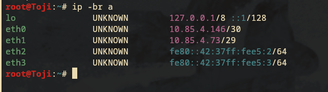 |
| 5 | **Shigeru** |  |
| 6 | **Makoto** |  |
| 7 | **Misato** | 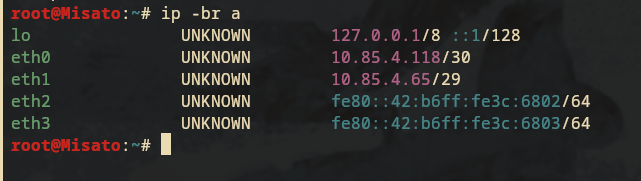 |
| 8 | **Kaji** | 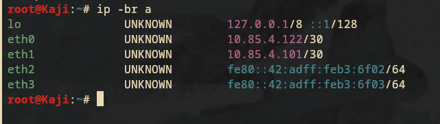 |
| 9 | **Asuka** |  |
| 10 | **Ritsuko** |  |
| 11 | **Kensuke** |  |
| 12 | **Hikari** | 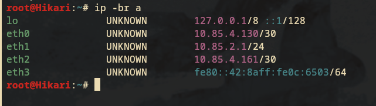 |
| 13 | **Kowaru** |  |
| 14 | **Yui** |  |
| 15 | **Mari** |  |
| 16 | **Rei** |  |
| 17 | **Shinji** | 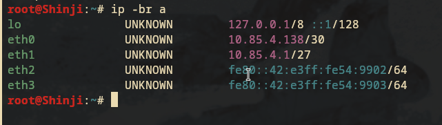 |

### B. Ping Dua Ujung Tiap Link Router-ke-Router
- **Gendow ke 7 Router Cabang**:  
  
- **Cabang Fuyutsuki & Shigeru**:  
  
- **Cabang Asuka & Hikari**:  
  
- **Cabang Yui**:  
  

---

## Soal 3 — Routing Statis & CIDR Summarization

Routing statis diterapkan secara hierarkis dengan jumlah rute seminimal mungkin:
- Setiap router selain Gendow memiliki satu **default route ke atas** (menuju router induk) dan rute spesifik ke subnet di bawahnya.
- Router **Gendow** menggunakan default route ke `NAT1` dan meringkas cabang yang dapat digabung tepat menjadi satu CIDR — salah satunya cabang **Shigeru** (`Switch-Monolith` `10.85.4.80/29` + `Switch-Radar` `10.85.4.88/29` → diringkas tepat menjadi `10.85.4.80/28`).

### Bukti Verifikasi
Ping dari **Armisael** (`10.85.4.83`) ke **Lilith** (`10.85.4.74`), **Sachiel** (`10.85.3.130`), dan **Comm-Net** (`10.85.2.2`) berhasil:  


---

## Soal 4 — Akses Internet & NAT Masquerade Gendo

- Router **Gendow** menerapkan NAT `MASQUERADE` pada interface WAN dinamis `eth7` khusus untuk prefix internal Geofront agar tidak perlu diubah saat IP dari NAT1 berganti, sekaligus menjaga alamat asli trafik antar-LAN:
  ```bash
  iptables -t nat -A POSTROUTING -s 10.85.0.0/16 -o eth7 -j MASQUERADE
  ```
- DNS nameserver dikonfigurasi di `/etc/resolv.conf` agar seluruh node dapat me-resolve nama domain.

### Bukti Verifikasi
- Ping ke `8.8.8.8` dan `deb.debian.org` dari node internal berhasil:  
  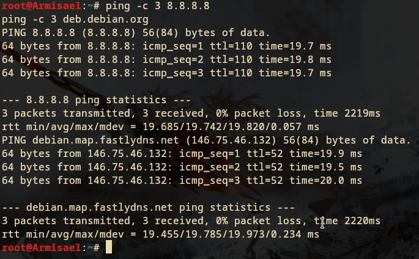
- Counter rule NAT `MASQUERADE` di Gendow bertambah (`iptables -t nat -nvL POSTROUTING`):  
  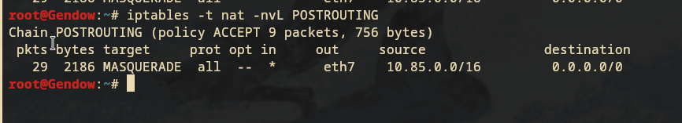

---

## Soal 5 — Firewall Hardening Gendo (Default Policy DROP)

Router **Gendow** dikunci dengan firewall stateful:
- Policy default chain `INPUT` dan `FORWARD` diatur menjadi `DROP`.
- Diizinkan secara eksplisit: loopback (`lo`), DHCP dari `NAT1` (`eth7`), koneksi `ESTABLISHED,RELATED`, trafik internal `10.85.0.0/16` keluar ke internet (`-o eth7`), trafik antar-LAN (`! -o eth7`), serta akses internal ke Gendow sendiri.
- Koneksi baru yang datang dari sisi `NAT1` otomatis ditolak.

### Bukti Verifikasi
- Daftar aturan firewall di router Gendow (`iptables -S`):  
  
- Uji ping ke `8.8.8.8` dari Armisael tetap berhasil di bawah policy `DROP`:  
  

---

## Soal 6 — IP Statis Permanen Non-Router & Uji Gateway Unit-01

- Seluruh **25 node client** non-router dikonfigurasi dengan IP statis dan default gateway sesuai aturan glosarium (gateway = IP usable pertama, node berurutan dari kiri ke kanan pada topologi).
- Konfigurasi dibuat permanen menggunakan `/root/<nama>.sh`, hook `/root/.bashrc`, dan `/etc/network/interfaces` (rincian lengkap di [`client-nodes-no6.txt`](client-nodes-no6.txt)).

### Bukti Verifikasi
Tampilan `ip -br a` dan ping ke gateway Misato (`10.85.4.65`) pada **Unit-01**:  
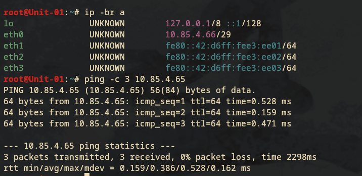

---

## Soal 7 — Membangunkan Layanan MAGI (Netcat Listener)

Listener `nc` dijalankan di latar belakang pada ketiga node MAGI:
- **Magi-Casper** (`10.85.4.58`): TCP Port `5000`
- **Magi-Balthasar** (`10.85.4.59`): TCP Port `5000` dan `5001`
- **Magi-Melchior** (`10.85.4.60`): TCP Port `5000`

### Bukti Verifikasi
- **Lilith** mengirim pesan ke keempat listener MAGI:  
  
- Pesan berhasil diterima dan dicatat di masing-masing node MAGI:  
  

---

## Soal 8 — Mengenali Kondisi Normal & Uji Layanan

Layanan normal diaktifkan dan diuji dari **Lilith**:
- **Pen-Pen** (`10.85.3.194`) port `80`: menjawab `Welcome to Pen-pen`
- **Tokyo3-Core** (`10.85.4.106`) port `80`: menjawab `Welcome to Tokyo3-Core`
- **Tokyo3-Core** (`10.85.4.106`) port `8080`: menjawab `syifa imutz`
- **Port `22` (tidak dilayani)**: langsung gagal seketika (`Connection refused`), tidak menggantung.

### Bukti Verifikasi


---

# Babak 2: Sabotase dan Hantu MAGI

Pada babak ini dilakukan analisis forensik jaringan serta perbaikan terhadap sabotase routing, NAT, dan firewall tanpa membatalkan prinsip keamanan yang diminta.

---

## Soal 9 — Jalur Belakang Diutak-atik (Routing Sabotage)

### Analisis Penyebab (`break_routing.sh` di Shigeru)
Lilith tidak mendapat balasan ping dari Armisael karena empat sabotase pada router **Shigeru**:
1. IP forwarding dimatikan (`sysctl -w net.ipv4.ip_forward=0`).
2. Rute `blackhole` dipasang untuk subnet Dogma/Lilith (`10.85.4.72/29`).
3. Policy routing diarahkan ke `table 100` yang berisi default route `blackhole`.
4. Default route utama dialihkan ke interface yang salah (`eth2` arah Makoto) bukan ke Gendow (`eth0`).

### Langkah Perbaikan di Shigeru
```bash
sysctl -w net.ipv4.ip_forward=1
ip route del blackhole 10.85.4.72/29 2>/dev/null
ip rule del lookup 100 2>/dev/null
ip route flush table 100 2>/dev/null
ip route replace default via 10.85.4.113 dev eth0
```

### Bukti Verifikasi
- Gejala Lilith ping Armisael gagal saat sabotase aktif:  
  
- Eksekusi perbaikan di router Shigeru:  
  
- Lilith kembali berhasil ping Armisael (`0% packet loss`):  
  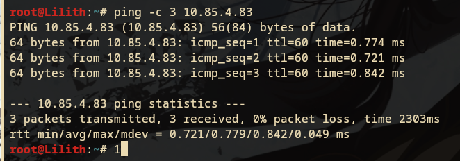

---

## Soal 10 — Para Pilot Terkunci di Dalam (NAT Sabotage)

### Analisis Sabotase & Jawaban Pertanyaan Laporan
1. **Mengapa Cage tidak bisa akses internet sedangkan Intel (Spy) bisa?**
   - **Di Misato**: Dipasang rule SNAT liar yang mengubah source IP subnet Cage (`10.85.4.64/29`) menjadi `172.31.99.1` sebelum diteruskan ke Gendow. Karena Gendow hanya me-NAT prefix internal `10.85.0.0/16`, paket Cage gagal di-masquerade.
   - **Di Gendow**: Dipasang rule `RETURN` pada urutan ke-1 chain `POSTROUTING` tabel NAT khusus untuk subnet Cage (`-s 10.85.4.64/29 -o eth7 -j RETURN`), sehingga melompati rule `MASQUERADE`.
   - **Intel (Spy)** tetap normal karena berada di subnet `10.85.4.100/30` di bawah router Kaji dan tidak menjadi target rule sabotase, sehingga tetap terkena `MASQUERADE` di Gendow.
2. **Di router mana saja translasi alamat sumber (NAT) seharusnya dilakukan?**
   - **Hanya di router Gendow** pada interface WAN dinamis (`eth7`). Router internal (Misato, Kaji, Shigeru, dll.) hanya melakukan *pure IP routing* antar-subnet internal dan tidak boleh melakukan SNAT.

### Langkah Perbaikan
- **Di Misato**: `iptables -t nat -F`
- **Di Gendow**: `iptables -t nat -D POSTROUTING -s 10.85.4.64/29 -o eth7 -j RETURN`

### Bukti Verifikasi
- Penghapusan rule `RETURN` di router Gendow:  
  
- **Unit-01** kembali berhasil ping `8.8.8.8` (`0% packet loss`):  
  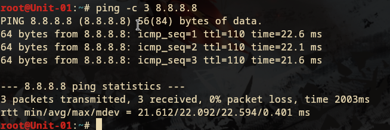

---

## Soal 11 — Casper Harus Jadi Hantu (ICMP Stealth)

**Magi-Casper** (`10.85.4.58`) dikonfigurasi agar menolak seluruh ping masuk (termasuk dari tetangga satu switch), namun tetap dapat mem-ping keluar ke node lain dan tetap melayani TCP port `5000`:
```bash
iptables -F INPUT
iptables -A INPUT -m conntrack --ctstate RELATED,ESTABLISHED -j ACCEPT
iptables -A INPUT -p icmp --icmp-type echo-request -j DROP
```

### Bukti Verifikasi
- Ping dari **Magi-Balthasar** ke Casper gagal (`100% loss`):  
  
- Ping dari **Lilith** ke Casper gagal (`100% loss`):  
  
- Ping dari **Magi-Casper** ke Balthasar berhasil (`0% loss`):  
  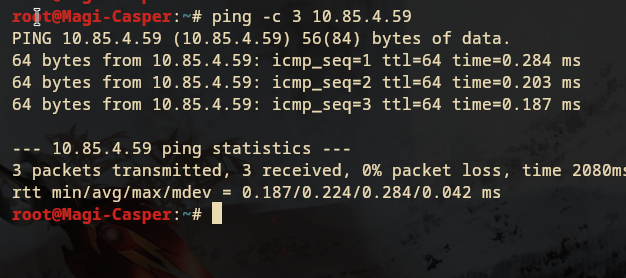
- Ping dari **Magi-Casper** ke Lilith berhasil (`0% loss`):  
  

---

## Soal 12 — Teknisi yang Kelewat Semangat (Firewall Hardening)

### Analisis Penyebab (`break_fw.sh` di Magi-Casper)
1. `iptables -A OUTPUT -p udp --dport 53 -j DROP` memblokir query DNS keluar sehingga `apt-get update` gagal me-resolve domain repositori.
2. `iptables -P INPUT DROP` tanpa rule `conntrack RELATED,ESTABLISHED` membuang seluruh paket balasan (echo-reply dari `8.8.8.8` maupun balasan HTTP repositori).
3. Tidak adanya rule `ACCEPT` untuk TCP port `5000` memblokir koneksi masuk dari Unit-00.

### Langkah Perbaikan (Policy `INPUT` Tetap `DROP`)
```bash
iptables -D OUTPUT -p udp --dport 53 -j DROP 2>/dev/null
iptables -I INPUT 1 -m conntrack --ctstate RELATED,ESTABLISHED -j ACCEPT
iptables -A INPUT -p tcp --dport 5000 -j ACCEPT
iptables -P INPUT DROP
iptables -A INPUT -i lo -j ACCEPT 2>/dev/null
```

### Bukti Verifikasi
- Eksekusi perbaikan firewall di Magi-Casper:  
  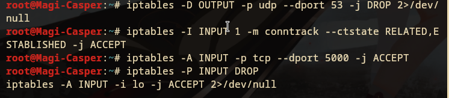
- Magi-Casper kembali berhasil ping `8.8.8.8`:  
  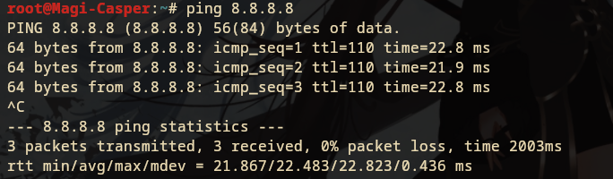
- Magi-Casper berhasil menjalankan `apt-get update`:  
  
- **Unit-00** berhasil menyambung ke TCP port `5000`, sementara ping ke Casper tetap ditolak (`100% loss`):  
  
- Pesan dari Unit-00 tercatat di `/root/received.log` Casper:  
  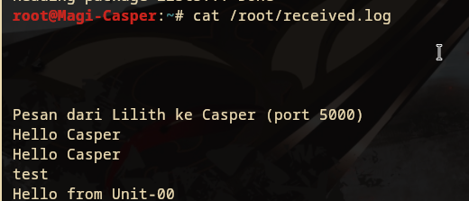

---

# Babak 3: Mengamankan MAGI dan Zona Sensitif

Pada babak ini diterapkan aturan keamanan tingkat lanjut menggunakan `iptables`: kontrol akses per-port, jadwal berbasis waktu (UTC), rate-limiting ICMP, logging & penolakan port scanning, pengalihan paket DNAT, perlindungan perimeter berbasis arah datang, dan isolasi total node pengkhianat.

---

## Soal 13 — Brankas Balthasar

Hanya **Magi-Casper** (`10.85.4.58`) dan seluruh **Pilot** (`Unit-01`, `Unit-02`, `Unit-00`, `Sachiel`) yang diizinkan mengakses TCP port `5000` dan `5001` di **Magi-Balthasar** (`10.85.4.59`). Node lain (termasuk tetangga satu switch seperti Melchior) langsung ditolak seketika menggunakan `REJECT --reject-with tcp-reset`, sementara trafik lain termasuk ping ke internet tetap lancar.
- Script: [`scripts/Babak3/soal13-balthasar.sh`](scripts/Babak3/soal13-balthasar.sh)

### Bukti Verifikasi
- Aturan firewall & ping internet di **Magi-Balthasar**:  
  
- **Unit-01** berhasil menyambung ke port `5000` dan `5001`:  
  
- **Lilith** langsung ditolak seketika (`Connection refused`):  
  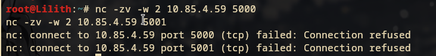
- **Magi-Melchior** (satu switch) langsung ditolak seketika (`Connection refused`):  
  

---

## Soal 14 — Jam Kunjungan Sang Pinguin

Akses `ping` dan TCP port `80` ke **Pen-Pen** (`10.85.3.194`) diatur berdasarkan jadwal UTC (`WIB - 7 jam`) dengan variabel `PILOT_START`, `PILOT_STOP`, `PILOT_DAYS`, `STAF_START`, dan `STAF_STOP` di awal script:

| Kelompok | Jadwal (WIB) | Jadwal (UTC di `iptables`) | Keterangan |
| :--- | :--- | :--- | :--- |
| **Pilot** (`Unit-01`, `Unit-02`, `Unit-00`, `Sachiel`) | `08.00–16.00` | `01:00–09:00` | Senin–Jumat (`Mon–Fri`) |
| **Staf Geofront** (`Lilith`, `Adam`) | `17.00–23.00` | `10:00–16:00` | Setiap hari |
| **Terduga Dummy System** (`Dummy-Plug`, `Entry-Plug`, `Spy`) | Tidak pernah | — | Selalu ditolak |
| **Lainnya** | Bebas | — | Tanpa batasan |

- Script: [`scripts/Babak3/soal14-pen-pen.sh`](scripts/Babak3/soal14-pen-pen.sh)

### Bukti Pengujian Kondisi 1 (Jadwal Cocok) vs Kondisi 2 (Jadwal Tidak Cocok)

| Node Uji | Kondisi 1 (Jadwal Cocok) | Kondisi 2 (Jadwal Tidak Cocok) |
| :--- | :--- | :--- |
| **Unit-01** (Pilot) | 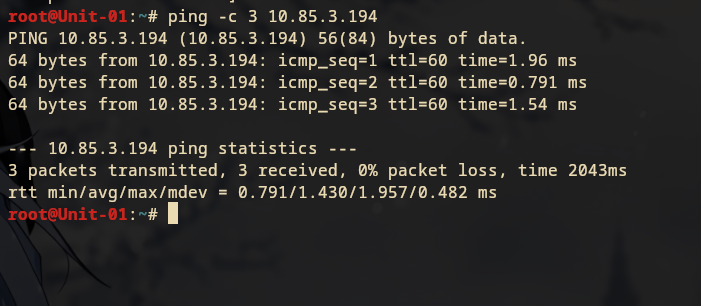 |  |
| **Lilith** (Staf) |  | 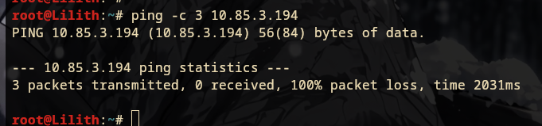 |
| **Spy** (Dummy) |  |  |

---

## Soal 15 — Banjir Ping di Pusat Komando

**Tokyo3-Core** (`10.85.4.106`) dibatasi agar hanya menjawab maksimal **5 ping per detik** (`-m limit --limit 5/sec --limit-burst 5`) dan membuang kelebihannya (`DROP`). Rule limit ditempatkan **sebelum** `RELATED,ESTABLISHED` agar stream flood ping tidak lolos conntrack, tanpa membatasi ping keluar dari Tokyo3-Core sendiri.
- Script: [`scripts/Babak3/soal15-tokyo3-core.sh`](scripts/Babak3/soal15-tokyo3-core.sh)

### Bukti Verifikasi
- Flood ping dari **Lilith** (`ping -i 0.1 -c 50 10.85.4.106`) sebagian terbuang:  
  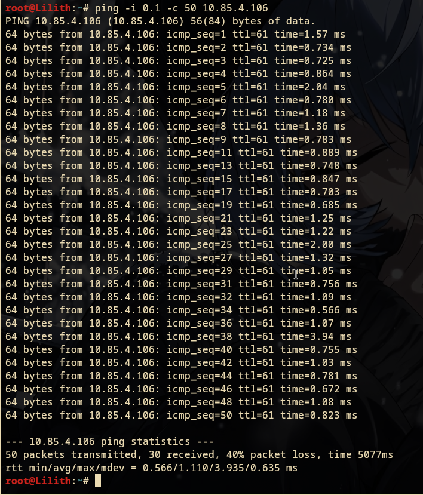
- Ping biasa dari **Lilith** (jeda ≥ 3 detik) berhasil 100%:  
  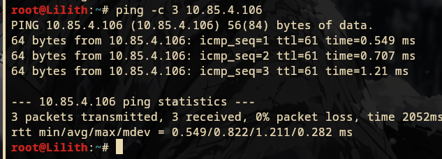
- Counter rule pembuangan (`DROP`) di **Tokyo3-Core** meningkat (`iptables -vnL INPUT`):  
  

---

## Soal 16 — Pencuri yang Mencoba Setiap Pintu

Setiap koneksi TCP dari **Dummy-Plug** (`10.85.4.51`) ke port sensitif **22, 23, dan 3306** di **Tokyo3-Core** dicatat dengan log prefix `SCAN-NERV: ` lalu langsung ditolak seketika (`REJECT --reject-with tcp-reset`). Port layanan **80** dan **8080** tetap dapat diakses normal.
- Script: [`scripts/Babak3/soal16-tokyo3-core.sh`](scripts/Babak3/soal16-tokyo3-core.sh)

### Bukti Verifikasi
- **Dummy-Plug** `nc` ke port `22, 23, 3306` langsung ditolak (`Connection refused`), sedangkan port `80` dan `8080` berhasil:  
  
- Counter rule pencatatan (`LOG prefix "SCAN-NERV: "`) dan `REJECT` di **Tokyo3-Core**:  
  

---

## Soal 17 — Sihir Hitam di Jalur Paket

Pada router **Fuyutsuki** (gateway Switch-Terminal), dipasang rule DNAT `PREROUTING` untuk mengalihkan setiap koneksi **TCP** dari **Magi-Casper** (`10.85.4.58`) ke **Zaruel** (`10.85.4.82`) agar dialihkan diam-diam ke **Pen-Pen** (`10.85.3.194`), tanpa mengalihkan ping. Conntrack di Fuyutsuki membalikkan alamat balasan sehingga Casper tetap melihat balasan seolah datang dari Zaruel.
- Script: [`scripts/Babak3/soal17-fuyutsuki.sh`](scripts/Babak3/soal17-fuyutsuki.sh)

### Bukti Verifikasi
- **Magi-Casper** mengirim pesan ke IP Zaruel (`10.85.4.82`) port `9000`:  
  
- Pesan muncul di **Pen-Pen**:  
  
- Log listener di **Zaruel** tetap kosong:  
  
- Tabel `conntrack` di **Fuyutsuki** menunjukkan aliran translasi ke `10.85.3.194`:  
  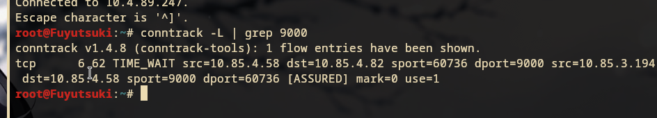

---

## Soal 18 — Gerbang Monolith dan Radar

Pada router **Shigeru**, diterapkan firewall perimeter berbasis **arah datang** (`-i eth0`, sisi yang menghadap Gendo) tanpa mendaftar subnet luar satu per satu:
- Node di dalam zona sensitif (`Switch-Monolith` & `Switch-Radar`) bebas memulai koneksi keluar dan menerima balasannya (`RELATED,ESTABLISHED`).
- Koneksi baru dari luar zona (`-i eth0`) ditolak (`DROP`), dengan satu pengecualian: **ping dari subnet Terminal (`10.85.4.56/29`)** diizinkan masuk.
- Script: [`scripts/Babak3/soal18-shigeru.sh`](scripts/Babak3/soal18-shigeru.sh)

### Bukti Verifikasi
- Daftar aturan `FORWARD` di **Shigeru**:  
  
- Ping **Magi-Casper** ke **Zaruel** berhasil (`0% loss`):  
  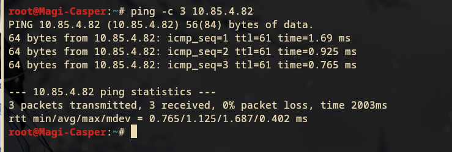
- Ping **Lilith** ke **Zaruel** gagal (`100% loss`):  
  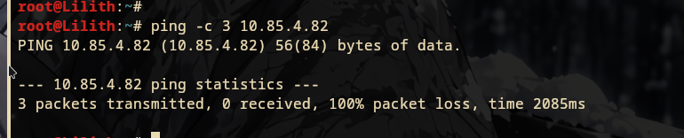

---

## Soal 19 — Hukuman untuk Sang Pengkhianat

**Armisael** (`10.85.4.83`) diisolasi total dari seluruh lalu lintas masuk maupun keluar (gateway, jaringan luar, maupun tetangga satu switch **Zaruel**) **tanpa mengubah apa pun di dalam Armisael**:
- Router **Shigeru** memblokir seluruh trafik dari/ke Armisael pada `INPUT`, `OUTPUT`, dan `FORWARD` (dengan tetap mempertahankan aturan Soal 18).
- Tetangga satu switch **Zaruel** memblokir seluruh trafik langsung dari/ke Armisael pada `INPUT` dan `OUTPUT`, sementara Zaruel sendiri tetap bebas berkomunikasi.
- Scripts: [`scripts/Babak3/soal19-shigeru.sh`](scripts/Babak3/soal19-shigeru.sh) & [`scripts/Babak3/soal19-zaruel.sh`](scripts/Babak3/soal19-zaruel.sh)

### Bukti Verifikasi
- **Armisael** gagal ping & `nc` ke Seele (`8.8.8.8` / TCP `53`), Zaruel (`10.85.4.82` / TCP `9000`), dan Lilith (`10.85.4.74` / TCP `9000`):  
  
- **Zaruel** tetap berhasil ping & `nc` ke Seele dan Lilith:  
  

---

# Babak Final: Siap Dihancurkan, Siap Dibangun Lagi

## Soal 20 — Uji Kebakaran Geofront

Uji pemulihan idempoten (*fire drill*) dilakukan pada **3 node** (**Fuyutsuki** sebagai router, **Magi-Balthasar**, dan **Tokyo3-Core**). Aturan disimpan terlebih dahulu dengan `iptables-save > /root/<nama>.rules`, kemudian seluruh rule `filter` & `nat` serta rute default dihapus, lalu dipulihkan **dua kali berturut-turut** menggunakan `iptables-restore` dan `/root/<nama>.sh`.
- Script: [`scripts/BabakFinal/soal20-uji-kebakaran.sh`](scripts/BabakFinal/soal20-uji-kebakaran.sh)

### Ringkasan Hasil Uji Pemulihan Idempoten

| Node | Pemulihan 1 (`filter` / `nat`) | Pemulihan 2 (`filter` / `nat`) | Ping `8.8.8.8` | Status |
| :--- | :---: | :---: | :---: | :---: |
| **Fuyutsuki** (Router) | `3` / `5` | `3` / `5` | `0% loss` | Identik & Normal |
| **Magi-Balthasar** | `11` / `4` | `11` / `4` | `0% loss` | Identik & Normal |
| **Tokyo3-Core** | `9` / `4` | `9` / `4` | `0% loss` | Identik & Normal |

### Bukti Verifikasi
- **Fuyutsuki** (Router):  
  
- **Magi-Balthasar**:  
  
- **Tokyo3-Core**:  
  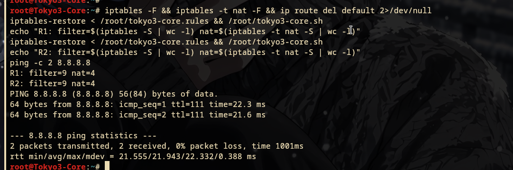
