# Laporan Resmi Praktikum Modul 5 Jaringan Komputer 2026
## *Operation Geofront* — Kelompok K-43

**Anggota Kelompok:**
- Kelompok K-43 (Group B — GNS3 Host: `10.4.89.247`)
- Blok Subnet: `10.85.0.0/16`

---

## Daftar Isi
1. [Babak 1 — Soal 1: Pembagian Alamat VLSM & Tree IP](#soal-1--pembagian-alamat-vlsm--tree-ip)
2. [Babak 1 — Soal 2: IP Addressing 17 Router & Ping Ujung Link](#soal-2--ip-addressing-17-router--ping-ujung-link)
3. [Babak 1 — Soal 3: Routing Statis & CIDR Summarization](#soal-3--routing-statis--cidr-summarization)
4. [Babak 1 — Soal 4: Akses Internet & NAT Masquerade Gendo](#soal-4--akses-internet--nat-masquerade-gendo)
5. [Babak 1 — Soal 5: Firewall Hardening Gendo (Default Policy DROP)](#soal-5--firewall-hardening-gendo-default-policy-drop)
6. [Babak 1 — Soal 6: IP Statis Permanen Non-Router & Uji Gateway Unit-01](#soal-6--ip-statis-permanen-non-router--uji-gateway-unit-01)
7. [Babak 1 — Soal 7: Membangunkan Layanan MAGI (Netcat Listener)](#soal-7--membangunkan-layanan-magi-netcat-listener)
8. [Babak 1 — Soal 8: Mengenali Kondisi Normal & Uji Layanan](#soal-8--mengenali-kondisi-normal--uji-layanan)

---

## Soal 1 — Pembagian Alamat VLSM & Tree IP
- Pembagian subnet dilakukan berdasarkan kebutuhan host terbesar (termasuk +1 gateway) dengan aturan tie-break: ukuran sama didahulukan segmen LAN dibanding link router-ke-router, kemudian urutan nomor tabel.
- File rincian subnetting tersedia pada spreadsheet: [`subneting.xlsx`](subneting.xlsx).
- Total segmen: 17 LAN dan 16 Link Point-to-Point (/30).

---

## Soal 2 — IP Addressing 17 Router & Ping Ujung Link
Setiap router dikonfigurasi dengan IP statis dan `net.ipv4.ip_forward=1`. Router Gendo memperoleh alamat dinamis dari NAT1 via interface WAN `eth7`.

### A. Tampilan `ip -br a` pada 17 Router
| No | Router | Screenshot |
|:--:|:-------|:-----------|
| 1 | **Gendow** | 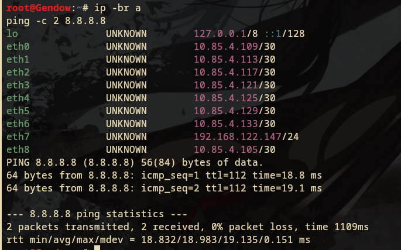 |
| 2 | **Fuyutsuki** | 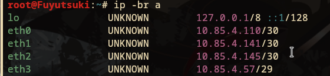 |
| 3 | **Maya** |  |
| 4 | **Toji** |  |
| 5 | **Shigeru** | 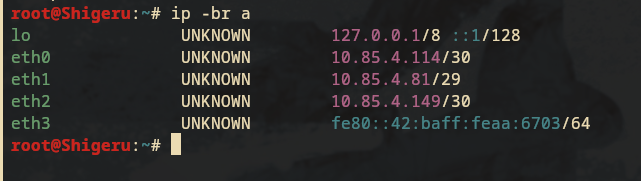 |
| 6 | **Makoto** | 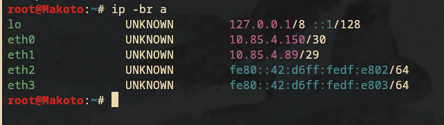 |
| 7 | **Misato** |  |
| 8 | **Kaji** |  |
| 9 | **Asuka** |  |
| 10 | **Ritsuko** | 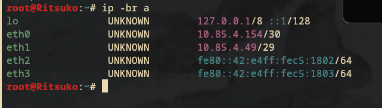 |
| 11 | **Kensuke** |  |
| 12 | **Hikari** |  |
| 13 | **Kowaru** | 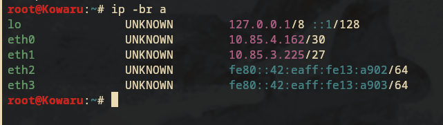 |
| 14 | **Yui** |  |
| 15 | **Mari** | 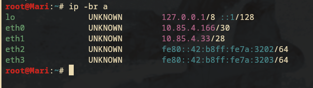 |
| 16 | **Rei** |  |
| 17 | **Shinji** |  |

### B. Ping Dua Ujung Tiap Link Router-ke-Router
- **Gendow ke 7 Router Cabang**:  
  
- **Cabang Fuyutsuki & Shigeru**:  
  
- **Cabang Asuka & Hikari**:  
  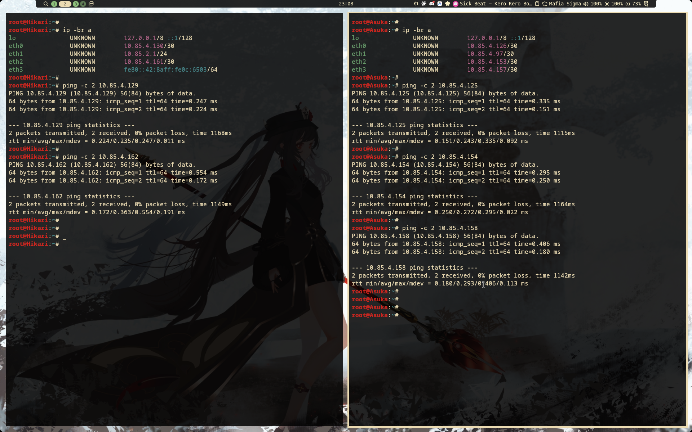
- **Cabang Yui**:  
  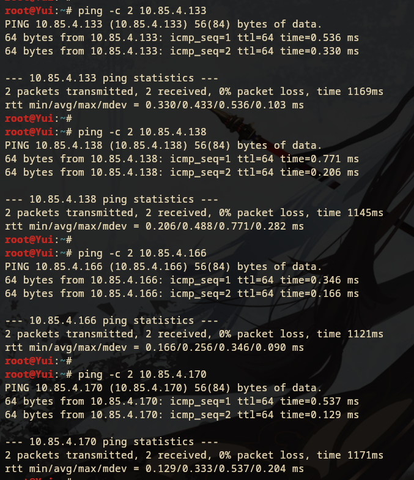

---

## Soal 3 — Routing Statis & CIDR Summarization
Routing statis diatur dengan prinsip hierarki efisien:
- Router cabang mengarahkan default route ke router induk di atasnya.
- Router Gendo mengarahkan rute spesifik ke masing-masing cabang, dengan ringkasan CIDR pada cabang Shigeru (Switch-Monolith `10.85.4.80/29` + Switch-Radar `10.85.4.88/29` diringkas tepat menjadi `10.85.4.80/28`).
- Bukti ping dari **Armisael** (`10.85.4.83`) ke:
  - **Lilith** (`10.85.4.74`)
  - **Sachiel** (`10.85.3.130`)
  - **Comm-Net** (`10.85.2.2`)  
  

---

## Soal 4 — Akses Internet & NAT Masquerade Gendo
- Router Gendo menerapkan NAT Masquerade pada dynamic WAN interface `eth7`:
  ```bash
  iptables -t nat -A POSTROUTING -s 10.85.0.0/16 -o eth7 -j MASQUERADE
  ```
- DNS nameserver dikonfigurasi pada `/etc/resolv.conf`.
- Bukti ping `8.8.8.8` dan domain `deb.debian.org` dari node internal:  
  
- Bukti counter rule NAT bertambah di Gendow (`iptables -t nat -nvL POSTROUTING`):  
  

---

## Soal 5 — Firewall Hardening Gendo (Default Policy DROP)
Router Gendo menerapkan firewall stateful:
- Policy default rantai `INPUT` dan `FORWARD` adalah `DROP`.
- Loopback `lo` dan DHCP WAN `eth7` diizinkan.
- Conntrack `ESTABLISHED,RELATED` diizinkan melintasi firewall.
- Internal `10.85.0.0/16` diizinkan keluar ke internet via `eth7`.
- Komunikasi antar-LAN internal diizinkan (`! -o eth7`).
- Akses internal ke router Gendo diizinkan untuk pemeliharaan.

### Bukti Aturan & Uji Firewall:
- Daftar aturan firewall di router Gendo (`iptables -S`):  
  
- Uji ping ke `8.8.8.8` dari Armisael membuktikan akses internet tetap berjalan di bawah policy DROP:  
  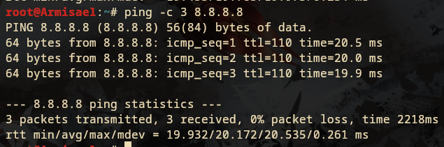

---

## Soal 6 — IP Statis Permanen Non-Router & Uji Gateway Unit-01
- Seluruh 25 node client non-router diberi IP statis dan default gateway sesuai aturan glosarium.
- Konfigurasi dipatenkan dengan script `/root/<nama>.sh`, auto-hook `/root/.bashrc`, dan `/etc/network/interfaces`.
- Bukti `ip -br a` dan ping ke gateway Misato (`10.85.4.65`) pada **Unit-01**:  
  

---

## Soal 7 — Membangunkan Layanan MAGI (Netcat Listener)
Layanan listener netcat diaktifkan pada:
- **Magi-Casper**: Port 5000
- **Magi-Balthasar**: Port 5000 & 5001
- **Magi-Melchior**: Port 5000

### Bukti Pengiriman & Penerimaan Pesan:
- Lilith mengirim pesan ke keempat listener:  
  
- Pesan diterima di masing-masing node MAGI:  
  

---

## Soal 8 — Mengenali Kondisi Normal & Uji Layanan
Layanan normal diuji dari node Lilith:
- **Pen-Pen** (Port 80): Menjawab `Welcome to Pen-pen`
- **Tokyo3-Core** (Port 80): Menjawab `Welcome to Tokyo3-Core`
- **Tokyo3-Core** (Port 8080): Menjawab `syifa imutz`
- **Port 22 (Tidak Dilayani)**: Langsung gagal (`Connection refused`), tidak menggantung.

### Bukti Uji Layanan:


---

# Babak 2: Sabotase dan Hantu MAGI

Pada babak ini dilakukan analisis forensik jaringan dan perbaikan terhadap sabotase konfigurasi routing, NAT, dan firewall yang mengganggu operasional Geofront.

---

## Soal 9 — Jalur Belakang Diutak-atik (Routing Sabotage)

### Analisis Sabotase
Lilith tidak bisa melakukan ping ke Armisael karena script sabotase `break_routing.sh` pada router **Shigeru**:
1. Menonaktifkan IP forwarding (`sysctl -w net.ipv4.ip_forward=0`).
2. Memasang rute blackhole untuk subnet Monolith (`ip route add blackhole 10.85.4.72/29`).
3. Mengarahkan policy routing ke table 100 dengan default route blackhole (`ip rule add ... lookup 100`).
4. Mengarahkan default route utama ke interface yang salah (`eth2` arah Makoto) bukan ke Gendow (`eth0`).

### Langkah Perbaikan di Shigeru:
```bash
sysctl -w net.ipv4.ip_forward=1
ip route del blackhole 10.85.4.72/29 2>/dev/null
ip rule del lookup 100 2>/dev/null
ip route flush table 100 2>/dev/null
ip route replace default via 10.85.4.113 dev eth0
```

### Bukti Gejala, Perbaikan, & Verifikasi:
- Gejala Lilith ping Armisael gagal saat sabotase aktif:  
  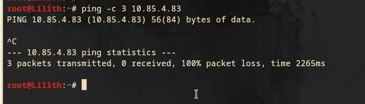
- Eksekusi langkah perbaikan di router Shigeru:  
  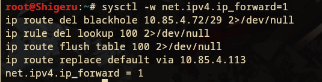
- Bukti verifikasi Lilith berhasil ping Armisael kembali (0% packet loss):  
  

---

## Soal 10 — Para Pilot Terkunci di Dalam (NAT Sabotage)

### Analisis Sabotase & Pertanyaan Laporan
1. **Mengapa Cage tidak bisa akses internet sedangkan Intel (Spy) bisa?**
   - **Di Misato**: Dipasang rule SNAT liar yang mengubah source IP Cage (`10.85.4.64/29`) menjadi `172.31.99.1` sebelum dikirim ke Gendow. Karena Gendow hanya me-NAT prefix internal Geofront (`10.85.0.0/16`), paket Cage tidak di-masquerade.
   - **Di Gendow**: Dipasang rule `RETURN` pada urutan pertama `POSTROUTING` untuk subnet Cage (`-s 10.85.4.64/29 -o eth7 -j RETURN`), mem-bypass rule `MASQUERADE`.
   - **Intel (Spy)** tetap bisa internetan karena Spy berada di subnet `10.85.4.100/30` di bawah router Kaji. Sabotase secara spesifik hanya menargetkan subnet Cage, sehingga trafik Spy tetap utuh dan lolos masquerade di Gendow.
2. **Di router mana saja translasi alamat sumber (NAT) seharusnya dilakukan?**
   - **Hanya di router Gendow** pada interface dinamis WAN (`eth7`). Router internal Geofront (seperti Misato, Kaji, Ritsuko, Shigeru, dll.) bertugas melakukan *pure IP routing* antar-subnet internal dan **tidak boleh** melakukan translasi alamat IP (SNAT).

### Langkah Perbaikan:
- **Di router Misato**: Hapus rule SNAT liar (`iptables -t nat -F`).
- **Di router Gendow**: Hapus rule RETURN bypass (`iptables -t nat -D POSTROUTING -s 10.85.4.64/29 -o eth7 -j RETURN`).

### Bukti Perbaikan & Uji Internet:
- Eksekusi perbaikan rule RETURN di router Gendow:  
  
- Bukti Unit-01 berhasil melakukan ping ke `8.8.8.8` (0% packet loss):  
  

---

## Soal 11 — Casper Harus Jadi Hantu (ICMP Stealth)

### Konfigurasi Firewall Stealth di Magi-Casper:
Casper tidak boleh merespon ping masuk dari siapapun (termasuk tetangga satu switch), namun Casper tetap bisa melakukan ping keluar ke siapa saja dan port TCP 5000 tetap melayani koneksi.
```bash
iptables -F INPUT
iptables -A INPUT -m conntrack --ctstate RELATED,ESTABLISHED -j ACCEPT
iptables -A INPUT -p icmp --icmp-type echo-request -j DROP
```

### Bukti Uji Stealth ICMP:
- Ping dari Balthasar ke Casper gagal (100% packet loss):  
  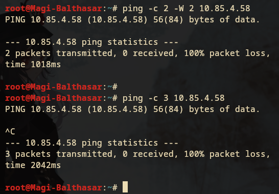
- Ping dari Lilith ke Casper gagal (100% packet loss):  
  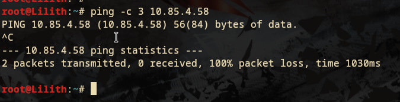
- Ping dari Casper ke Balthasar berhasil (0% packet loss):  
  
- Ping dari Casper ke Lilith berhasil (0% packet loss):  
  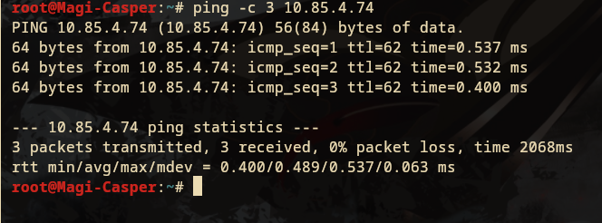

---

## Soal 12 — Teknisi yang Kelewat Semangat (Firewall Hardening)

### Analisis Kerusakan Script Hardening:
1. `iptables -A OUTPUT -p udp --dport 53 -j DROP`: Memblokir DNS query keluar dari Casper sehingga `apt-get update` gagal me-resolve domain.
2. `iptables -P INPUT DROP` tanpa rule conntrack: Menolak seluruh paket masuk, termasuk balasan ping dan balasan HTTP repositori.
3. Tidak ada rule ACCEPT untuk TCP port 5000: Menolak koneksi netcat masuk dari Unit-00.

### Langkah Perbaikan di Magi-Casper (Mempertahankan Hardening & Policy DROP):
```bash
iptables -D OUTPUT -p udp --dport 53 -j DROP 2>/dev/null
iptables -I INPUT 1 -m conntrack --ctstate RELATED,ESTABLISHED -j ACCEPT
iptables -A INPUT -p tcp --dport 5000 -j ACCEPT
iptables -P INPUT DROP
iptables -A INPUT -i lo -j ACCEPT 2>/dev/null
```

### Bukti Perbaikan & Uji Layanan:
- Eksekusi perbaikan aturan firewall di Magi-Casper:  
  
- Casper berhasil ping ke `8.8.8.8` (0% packet loss):  
  
- Casper berhasil menjalankan `apt-get update`:  
  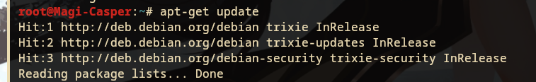
- Unit-00 berhasil menyambung ke TCP port 5000 dan ping ke Casper tetap ditolak (100% loss):  
  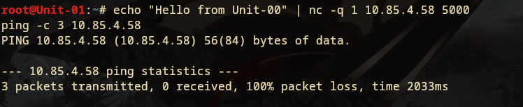
- Pesan dari Unit-00 terekam di `/root/received.log` Casper:  
  


---

# Babak 3: Mengamankan MAGI dan Zona Sensitif

Pada babak ini diterapkan aturan keamanan tingkat lanjut menggunakan `iptables` pada layanan MAGI, jadwal akses berbasis waktu, rate-limiting ICMP, logging & penolakan port scanning, pengalihan paket DNAT, perlindungan perimeter zona sensitif, serta isolasi total node pengkhianat.

---

## Soal 13 — Brankas Balthasar

Hanya **Magi-Casper** (`10.85.4.58`) dan seluruh **Pilot** (`Unit-01`, `Unit-02`, `Unit-00`, `Sachiel`) yang diizinkan mengakses TCP port `5000` dan `5001` di **Magi-Balthasar** (`10.85.4.59`). Node lain (termasuk tetangga satu switch seperti Melchior) langsung ditolak seketika menggunakan `REJECT --reject-with tcp-reset`.
- Script: [`scripts/Babak3/soal13-balthasar.sh`](scripts/Babak3/soal13-balthasar.sh)

### Bukti Verifikasi:
- Aturan firewall & uji ping internet (`8.8.8.8`) di **Magi-Balthasar**:  
  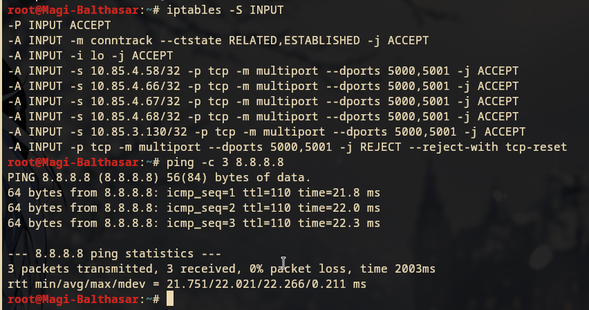
- **Unit-01** berhasil menyambung ke port `5000` dan `5001`:  
  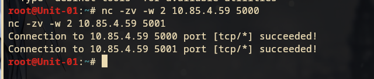
- **Lilith** ditolak seketika (`Connection refused`):  
  
- **Magi-Melchior** (satu switch) ditolak seketika (`Connection refused`):  
  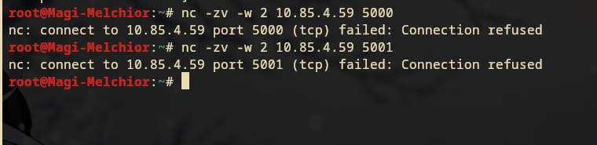

---

## Soal 14 — Jam Kunjungan Sang Pinguin

Akses `ping` dan TCP port `80` ke **Pen-Pen** (`10.85.3.194`) dibatasi berdasarkan jadwal UTC (WIB – 7 jam) dengan variabel `PILOT_START`, `PILOT_STOP`, `PILOT_DAYS`, `STAF_START`, dan `STAF_STOP` di awal script:
- **Pilot**: `08.00–16.00 WIB` (`01:00–09:00 UTC`), Senin–Jumat.
- **Staf Geofront**: `17.00–23.00 WIB` (`10:00–16:00 UTC`), setiap hari.
- **Terduga Dummy System** (`Dummy-Plug`, `Entry-Plug`, `Spy`): selalu ditolak.
- **Lainnya**: bebas tanpa batasan.
- Script: [`scripts/Babak3/soal14-pen-pen.sh`](scripts/Babak3/soal14-pen-pen.sh)

### Bukti Uji Kondisi 1 (Jadwal Cocok dengan Jam Sekarang):
- **Unit-01** berhasil ping Pen-Pen:  
  
- **Lilith** berhasil ping Pen-Pen:  
  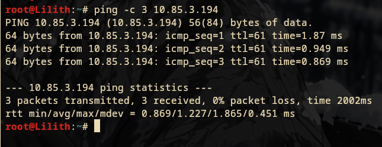
- **Spy** (Dummy System) tetap ditolak (100% loss):  
  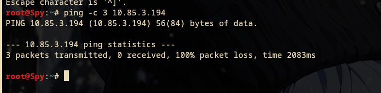

### Bukti Uji Kondisi 2 (Jadwal Tidak Cocok dengan Jam Sekarang):
- **Unit-01** ditolak (100% loss):  
  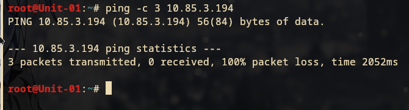
- **Lilith** ditolak (100% loss):  
  
- **Spy** tetap ditolak (100% loss):  
  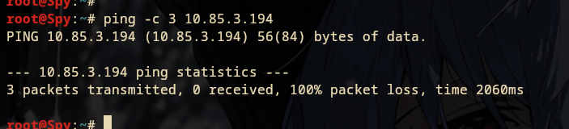

---

## Soal 15 — Banjir Ping di Pusat Komando

**Tokyo3-Core** (`10.85.4.106`) dibatasi agar hanya menjawab maksimal **5 ping per detik** (`-m limit --limit 5/sec --limit-burst 5`) dan membuang kelebihannya (`DROP`). Rule diletakkan sebelum `RELATED,ESTABLISHED` agar stream flood ping tidak lolos conntrack, tanpa mengganggu ping keluar dari Tokyo3-Core sendiri.
- Script: [`scripts/Babak3/soal15-tokyo3-core.sh`](scripts/Babak3/soal15-tokyo3-core.sh)

### Bukti Verifikasi:
- Flood ping dari **Lilith** (`ping -i 0.1 -c 50 10.85.4.106`) sebagian terbuang:  
  
- Ping biasa dari **Lilith** setelah jeda ≥ 3 detik berhasil 100%:  
  
- Counter rule pembuangan (`DROP`) pada `iptables -vnL INPUT` di **Tokyo3-Core** naik:  
  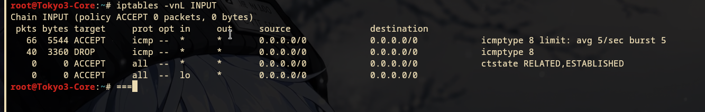

---

## Soal 16 — Pencuri yang Mencoba Setiap Pintu

Koneksi TCP dari **Dummy-Plug** (`10.85.4.51`) ke port sensitif **22, 23, dan 3306** di **Tokyo3-Core** dicatat dengan log prefix `SCAN-NERV: ` lalu ditolak seketika (`REJECT --reject-with tcp-reset`). Port layanan **80** dan **8080** tetap terbuka.
- Script: [`scripts/Babak3/soal16-tokyo3-core.sh`](scripts/Babak3/soal16-tokyo3-core.sh)

### Bukti Verifikasi:
- **Dummy-Plug** `nc` ke port `22, 23, 3306` langsung ditolak (`Connection refused`), sedangkan port `80` dan `8080` berhasil:  
  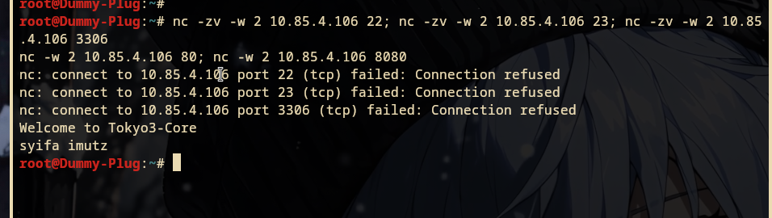
- Counter rule pencatatan (`LOG prefix "SCAN-NERV: "`) dan `REJECT` di **Tokyo3-Core**:  
  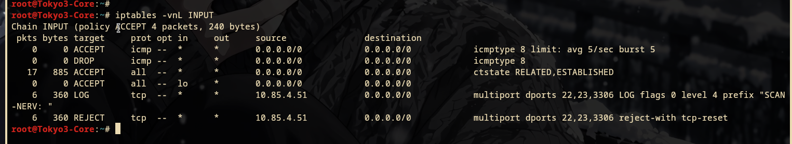

---

## Soal 17 — Sihir Hitam di Jalur Paket

Pada router **Fuyutsuki** (gateway Switch-Terminal), dipasang rule DNAT `PREROUTING` untuk mengalihkan seluruh koneksi TCP dari **Magi-Casper** (`10.85.4.58`) tujuan **Zaruel** (`10.85.4.82`) agar dialihkan diam-diam ke **Pen-Pen** (`10.85.3.194`), tanpa mengalihkan ICMP ping.
- Script: [`scripts/Babak3/soal17-fuyutsuki.sh`](scripts/Babak3/soal17-fuyutsuki.sh)

### Bukti Verifikasi:
- **Magi-Casper** mengirim pesan ke IP Zaruel (`10.85.4.82`) port `9000`:  
  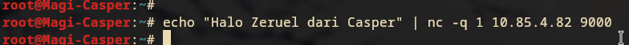
- Pesan masuk dan terbaca di **Pen-Pen**:  
  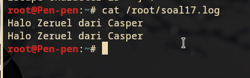
- Log listener di **Zaruel** tetap kosong:  
  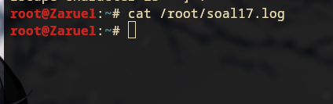
- Tabel `conntrack` di **Fuyutsuki** membuktikan translasi aliran paket ke `10.85.3.194`:  
  

---

## Soal 18 — Gerbang Monolith dan Radar

Pada router **Shigeru**, diterapkan perimeter berbasis arah datang (`-i eth0`, interface yang menghadap Gendo). Node dari dalam zona bebas memulai koneksi keluar beserta balasannya (`RELATED,ESTABLISHED`), sedangkan koneksi baru dari luar zona ditolak, dengan pengecualian ping dari subnet Terminal (`10.85.4.56/29`).
- Script: [`scripts/Babak3/soal18-shigeru.sh`](scripts/Babak3/soal18-shigeru.sh)

### Bukti Verifikasi:
- Daftar aturan `FORWARD` di **Shigeru**:  
  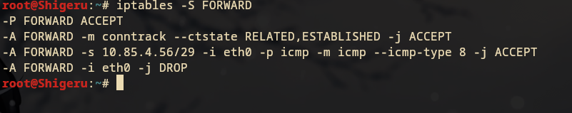
- Ping **Magi-Casper** ke **Zaruel** berhasil (0% loss):  
  
- Ping **Lilith** ke **Zaruel** gagal (100% loss):  
  

---

## Soal 19 — Hukuman untuk Sang Pengkhianat

**Armisael** (`10.85.4.83`) diisolasi total dari seluruh lalu lintas masuk maupun keluar (termasuk ke gateway, luar jaringan, dan tetangga satu switch **Zaruel**) **tanpa mengubah konfigurasi di dalam Armisael**:
- Blokir trafik ke/dari Armisael di router **Shigeru** (`INPUT`, `OUTPUT`, `FORWARD`) dan di tetangga satu switch **Zaruel** (`INPUT`, `OUTPUT`).
- Scripts: [`scripts/Babak3/soal19-shigeru.sh`](scripts/Babak3/soal19-shigeru.sh) & [`scripts/Babak3/soal19-zaruel.sh`](scripts/Babak3/soal19-zaruel.sh)

### Bukti Verifikasi:
- **Armisael** gagal ping & `nc` ke Seele (`8.8.8.8` / TCP 53), Zaruel (`10.85.4.82` / TCP 9000), dan Lilith (`10.85.4.74` / TCP 9000):  
  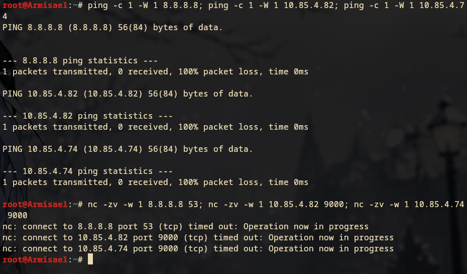
- **Zaruel** tetap bebas mengakses Seele dan Lilith (ping & `nc` berhasil):  
  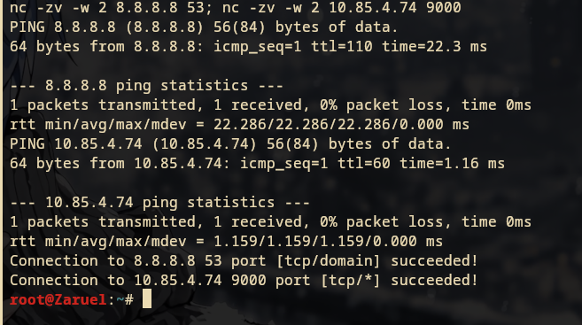

---

# Babak Final: Siap Dihancurkan, Siap Dibangun Lagi

## Soal 20 — Uji Kebakaran Geofront

Uji pemulihan (*idempotent fire drill*) dilakukan pada 3 node (**Fuyutsuki** sebagai router, **Magi-Balthasar**, dan **Tokyo3-Core**). Rule disimpan dengan `iptables-save > /root/<nama>.rules`, kemudian seluruh rule filter & nat serta rute default dihapus, lalu dipulihkan **dua kali berturut-turut** menggunakan `iptables-restore` dan `/root/<nama>.sh`.
- Script: [`scripts/BabakFinal/soal20-uji-kebakaran.sh`](scripts/BabakFinal/soal20-uji-kebakaran.sh)

### Bukti Pemulihan Idempoten (Jumlah Baris `filter` & `nat` Identik + Ping Internet Berhasil):
- **Fuyutsuki** (Router): `R1 == R2` (`filter=3`, `nat=5`) & ping `8.8.8.8` berhasil:  
  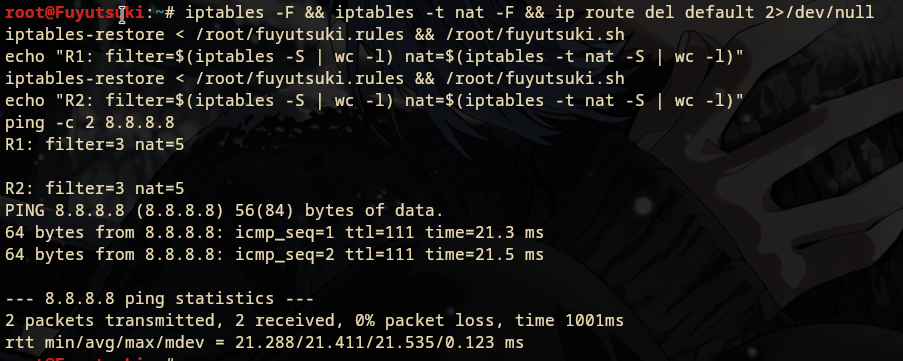
- **Magi-Balthasar**: `R1 == R2` (`filter=11`, `nat=4`) & ping `8.8.8.8` berhasil:  
  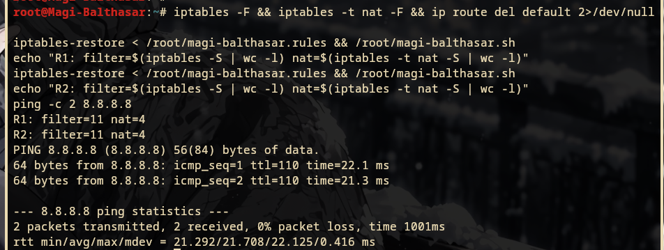
- **Tokyo3-Core**: `R1 == R2` (`filter=9`, `nat=4`) & ping `8.8.8.8` berhasil:  
  
